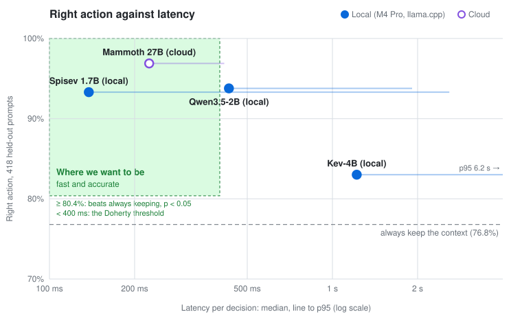

# Auto Compact

A Claude Code mod that notices when a prompt starts a new task and offers to compact or clear
the context before it is sent. A decision model reads a summary of the session and the new
prompt, and puts the prompt in one of five categories: it continues the current task, follows
up on it, starts a related task, starts an unrelated one, or returns to an earlier one. A
follow-up keeps everything; a related task is worth a compaction that keeps the general
picture; an unrelated one is worth a `/clear`.

The local model is **[Spisev](https://huggingface.co/arthur-fontaine/spisev-alpha-GGUF)** (spisev-alpha), a small model distilled from Baseten's Mammoth
that runs on your machine with llama.cpp; any System One endpoint (Mammoth, Jev) works too.

## Install

At the prompt of a terminal session:

```
/plugin install auto-compact --marketplace arthur-fontaine/cc-mod-auto-compact
```

From a shell: `claude plugin install auto-compact --marketplace arthur-fontaine/cc-mod-auto-compact`.

Then pick a provider with `/auto-compact setup`. Until then the mod does nothing.

## Providers

- **[Spisev](https://huggingface.co/arthur-fontaine/spisev-alpha-GGUF) (local)**: `/auto-compact setup` asks before downloading the GGUF (about
  1.9 GB) from Hugging Face and starts `llama-server` on 127.0.0.1 with `-hf`, for the rest of
  the session. It needs llama.cpp build 11361 or later (`llama-server` or `llama` on your PATH, or
  `AUTO_COMPACT_LLAMA_SERVER`). A `.gguf` path in `AUTO_COMPACT_MODEL` is served with `-m`.
- **Mammoth (Baseten)** or **Jev (OpenCode Zen)**: setup saves the endpoint and model; the
  key is read from `AUTO_COMPACT_API_KEY` in the environment and never stored. Any other
  System One endpoint works with `AUTO_COMPACT_ENDPOINT` and `AUTO_COMPACT_MODEL`.

## Privacy

With Spisev nothing leaves the machine. With a cloud provider, only the clipped state goes
out: the session's summary lines and the new prompt. The summaries themselves are written by
Claude Haiku through your own Claude Code session (`$.model.complete`), like any other request
of the session.

## Commands

- `/auto-compact`: the provider, the mode, the state of the summary tree and the last decision.
- `/auto-compact setup`: choose a provider.
- `/auto-compact mode off|suggest|auto`: saved across sessions.

In **suggest** mode (the default), a prompt that looks like a related, returning or unrelated
task opens a question before it is sent: compact (or clear) first, or send it as is. Nothing
happens without your press. It asks only at a confidence of `AUTO_COMPACT_SUGGEST_CONFIDENCE`
(0.6) or more: below that, Spisev's suggestions were right half the time on the
[benchmark](#benchmark) (13 of 25), and from there on 64 of 67. In **auto** mode the mod acts only when the decision's confidence
is at least `AUTO_COMPACT_MIN_CONFIDENCE` (0.85). `continuation` and `follow_up` never act. The
mod never acts on subagents, on a timeout or an error, without a provider, or while the
previous turn's summaries are still being built (the status line says
`auto-compact: summaries catching up`).

Acting holds the prompt back (Claude Code does not compact under a prompt being submitted),
compacts with the current summary lines as what to keep, or runs `/clear`, then sends the same
prompt. A prompt with attachments is never held back. The footer shows each decision:
`context kept · 92%`, `compact? related · 71%`, `cleared · independent · 91%`; the debug log has
`[auto-compact] <category> · <confidence> → <action>`.

## Environment variables

| Variable | Default | |
| :- | :- | :- |
| `AUTO_COMPACT_PROVIDER` | none | `spisev`, or `systemone` (implied by an endpoint) |
| `AUTO_COMPACT_ENDPOINT` | Spisev: `http://127.0.0.1:8766/v1/systemone` | a System One endpoint |
| `AUTO_COMPACT_MODEL` | Spisev: `arthur-fontaine/spisev-alpha-GGUF:Q8_0` | the endpoint's model, or a GGUF for llama-server |
| `AUTO_COMPACT_AUTH` | `Bearer` | `Api-Key` for Baseten |
| `AUTO_COMPACT_API_KEY` | | the cloud provider's key, never stored |
| `AUTO_COMPACT_MODE` | `suggest` | overrides the saved mode |
| `AUTO_COMPACT_MIN_CONFIDENCE` | `0.85` | auto mode's threshold |
| `AUTO_COMPACT_SUGGEST_CONFIDENCE` | `0.6` | suggest mode's threshold |
| `AUTO_COMPACT_TIMEOUT_MS` | `4000` | a slower answer keeps the context |
| `AUTO_COMPACT_SUMMARIZER_MODEL` | `claude-haiku-5-5` | a full model id |
| `AUTO_COMPACT_DATA_DIR` | `~/.claude/plugins/data/auto-compact` | where each session's summary tree is saved |
| `AUTO_COMPACT_LLAMA_SERVER` | `llama-server`, then `llama` | |

## How it decides

After each turn the mod summarizes the new messages with Haiku into an
[OptChat](https://gist.github.com/VictorTaelin/91837951a5ce5b38f341ec1ba1df6449) tree: each message
becomes a line of at most 512 bytes, and adjacent lines merge in pairs. On each prompt it sends
the view (the last 16 messages one line each, older ones as coarser lines) and the prompt to
the decision model, clipped to 12,000 tokens, and maps the category it picks through an
editable table. The same code builds the training data
([training/README.md](training/README.md)); parity tests check that the mod and the pipeline
clip, summarize and ask alike.

## Benchmark



**The test**: 418 decisions, from 334 held-out prompts of 94 real coding sessions plus 84
held-out splices (the end of one session followed by the first prompt of another, where the
context should go). None of these sessions was used for training or to pick a checkpoint. The
answer key is the action two Claude teachers, Sonnet 5.5 and Opus 5.5, agreed on after seeing
what the classifier sees plus hindsight: the last 8 messages, what the agent did next
and the developer's following prompts. They agreed on 96% of the points; the rest are left
out. Always keeping the context gets 76.8% right.

**The setup**: each model got the request the mod sends it, one at a time. The local models
ran in llama.cpp b11669 on an Apple M4 Pro with 24 GB. Elephant and Mammoth, from the same
lab, ran on Baseten; their latency includes the round trip from that Mac.

**The green zone** is where a decision model should be. Both edges are set by a rule, not
read off the results:

- **Fast**: under 400 ms at the median, the
  [Doherty threshold](https://lawsofux.com/doherty-threshold/), below which people stay
  engaged instead of waiting. The mod asks before every prompt, so this is time added to
  each one.
- **Accurate**: at least 80.4%, the lowest score that beats always keeping the context by
  more than chance on these points (one-sided exact binomial test, p < 0.05), computed by
  [`benchmark.py`](training/pipeline/benchmark.py).

| Model | Runs | Right action | Kept when it should | Acted when it should | Right action, auto mode | Right category | Latency p50 / p95 |
| :- | :- | -: | -: | -: | -: | -: | -: |
| **[Spisev 1.7B](https://huggingface.co/arthur-fontaine/spisev-alpha-GGUF)** | Local · llama.cpp · Q8_0, 1.8 GB | 93.3% | 97.5% | 79.4% | 87.1% | 81.5% | 138 / 2590 ms |
| Qwen3.5-2B, same recipe | Local · llama.cpp · Q8_0, 2.0 GB | 93.8% | 97.2% | 82.5% | 87.8% | 83.6% | 431 / 1913 ms |
| [Kev-4B](https://huggingface.co/mys/kev-4b-GGUF) | Local · llama.cpp · Q8_0, 4.5 GB | 83.0% | 87.5% | 68.0% | 76.8% | 62.0% | 1219 / 6225 ms |
| Elephant 9B | Cloud · Baseten | 94.3% | 98.1% | 81.4% | 86.6% | 74.7% | 194 / 276 ms |
| Mammoth 27B | Cloud · Baseten | 96.9% | 98.4% | 91.8% | 91.9% | 86.8% | 225 / 415 ms |
| Always keep | | 76.8% | 100% | 0% | 76.8% | | |

- **Right action**: the model's category, through the [policy](#how-it-decides), leads to
  the teachers' action: keep, compact or clear.
- **Kept when it should**: of the 321 points where the teachers keep the context, how many
  the model keeps. A miss here is the costly one: it drops context the agent needed.
- **Acted when it should**: of the 97 points where the teachers compact or clear, how many
  the model handles the same way.
- **Right action, auto mode**: what the mod ends up doing in auto mode. It acts only at a
  confidence of 0.85 or more and within its 4 s timeout, and otherwise keeps the context.
- **Right category**: the exact category, on the 379 points where the teachers also agreed
  on it.

What stands out:

- **Every model beats always keeping**, compared point by point (one-sided exact McNemar
  test): Spisev, Qwen3.5-2B, Elephant and Mammoth at p < 0.0001, Kev at p = 0.007.
- **Spisev, Qwen3.5-2B and Elephant are tied**: against Spisev, 13 points only Qwen3.5-2B
  gets right and 11 the other way (p = 0.84); 14 only Elephant and 10 the other way
  (p = 0.54). Spisev answers three times faster than Qwen3.5-2B at the median, and needs no
  network or key, which is why it is the default. Elephant is the steadiest: 276 ms at p95,
  but it gets the exact category less often (74.7%).
- **Mammoth is ahead of Spisev** (6 points against 21, p = 0.006), as expected: it is the
  teacher Spisev was distilled from, at 16 times the size. It needs the network and a
  Baseten key; Spisev runs on the Mac.
- **Kev drops context it should keep**: it compacts or clears 12.5% of the prompts the
  teachers keep, five times as often as Spisev. It is never confident enough for auto mode
  (no answer at 0.85 or more, median 0.38), so in auto mode it does exactly what always
  keeping does. It answers zero-shot; it was trained for [auto-effort](https://github.com/arthur-fontaine/cc-mod-auto-effort)'s question,
  not this one.
- **The local p95 is prefill, not noise**: the slowest 10% of states are 3k to 11k tokens,
  against 650 at the median, and the M4 Pro reads 2,000 tokens a second at 1k falling to
  1,300 at 8k (llama-bench; larger batches or flash attention do not help). The prompt
  cache saves little there, since the coarse lines at the front of the view change as the
  session grows. Spisev passed the 4 s timeout on 3 of 345 prompts, where the mod keeps the
  context; Kev on 47. The cloud models read long states on bigger GPUs: their p95 stays
  under 0.5 s.

To rerun it, run `uv run python pipeline/benchmark.py` then `uv run python pipeline/plot.py`
in [`training/`](training/README.md#benchmark), which also explains how the answer key and
Spisev were built.

## Development

```sh
pnpm test        # claude plugin test
pnpm validate    # claude plugin validate . --strict
pnpm eval        # the configured provider on sample decisions (reads .env)
claude --plugin-dir .
```
